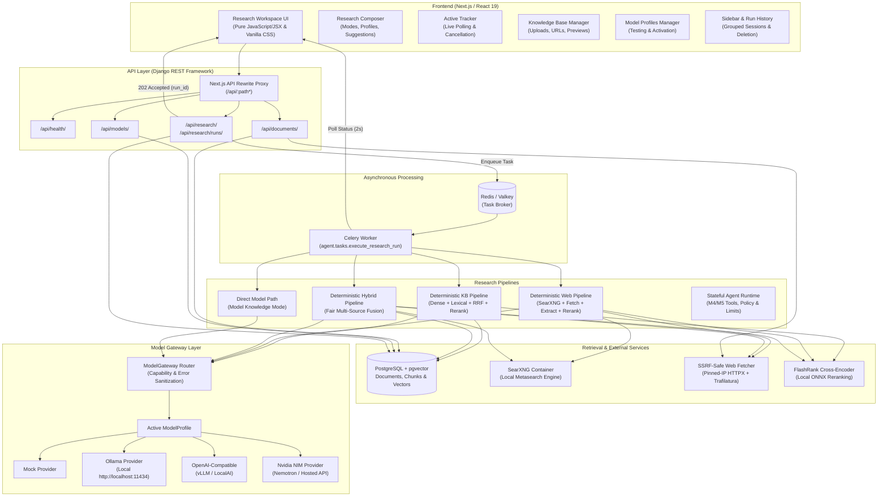

# AURA — Autonomous Research & Engineering Agent

[](https://www.python.org/)
[](https://www.djangoproject.com/)
[](https://nextjs.org/)
[](https://react.dev/)
[](https://github.com/pgvector/pgvector)
[](https://docs.celeryq.dev/)

AURA is an **open-model-first, LLM-agnostic agentic research and engineering platform**. It investigates complex questions, ingests and searches organizational knowledge, explores the live web, synthesizes evidence-backed findings, and presents verifiable citations through an interactive web workspace.

---

## Table of Contents

- [Overview](#overview)
- [Key Capabilities](#key-capabilities)
- [System Architecture](#system-architecture)
- [Technology Stack](#technology-stack)
- [Repository Structure](#repository-structure)
- [Prerequisites & System Requirements](#prerequisites--system-requirements)
- [Installation & Local Setup](#installation--local-setup)
- [Getting Started: Using AURA](#getting-started-using-aura)
- [Configuration Reference](#configuration-reference)
- [Research Modes & Pipelines](#research-modes--pipelines)
- [Knowledge Base & Ingestion](#knowledge-base--ingestion)
- [Model Profiles & Gateway](#model-profiles--gateway)
- [Research Workspace UI](#research-workspace-ui)
- [REST API Reference](#rest-api-reference)
- [Testing & Quality Assurance](#testing--quality-assurance)
- [Project Status & Roadmap](#project-status--roadmap)
- [Security Considerations](#security-considerations)
- [Contributing & Development Workflow](#contributing--development-workflow)

---

## Overview

AURA is built on the core principle that an intelligent research platform must not be tied to a single model vendor or proprietary inference API:

> **AURA is not an OpenAI application. AURA is an open-model-first, LLM-agnostic platform whose core architecture remains independent of model providers.**

The system maintains strict architectural boundaries:

1. **Inference Abstraction**: The internal **Model Gateway** decouples all research and generation logic from underlying LLMs (local Ollama instances, open-source models via vLLM, NVIDIA NIM, OpenAI-compatible endpoints, or deterministic offline mock providers).
2. **User-Configurable Model Profiles**: Users can configure, test, switch, and activate model profiles at runtime via the UI or REST API without restarting services or editing code.
3. **Deterministic Fast Paths**: Rather than wasting latency and tokens on unconstrained multi-step LLM planning loops for standard lookups, AURA uses deterministic retrieval-first pipelines (dense vector search, lexical full-text search, Reciprocal Rank Fusion, and FlashRank cross-encoder reranking) with **exactly one** generation call for final synthesis.
4. **Verifiable Citations**: In retrieval-augmented modes, conclusions are grounded in retrieved document chunks or web resources with standardized citation formats (`[Title, Page: X, Chunk: ID]` or `[Title, URL, Chunk: ID]`). AURA is designed to prevent invented citations and explicitly signals when evidence is insufficient, while Model Knowledge mode provides ungrounded generation directly from model weights.
5. **Decoupled Asynchronous Runtime**: Research runs are orchestrated asynchronously via Celery and Redis with persistent state tracking in PostgreSQL, supporting live polling, elapsed timing, cancellation, and full run history restoration.

---

## Key Capabilities

### Autonomous Research & Synthesis
- **4 Dedicated Research Modes**: Model Knowledge, Knowledge Base, Web, and Web + Knowledge Base (Hybrid).
- **Single-Call Grounded Generation**: Deterministic fast-path pipelines execute multi-source retrieval, fusion, and cross-encoder reranking before invoking the model gateway exactly once.
- **Strict Evidence Attribution**: Preserves provenance for every retrieved chunk; designed to prevent fabricated citations in retrieval modes by enforcing chunk-level verification against actual indexed or fetched content.
- **Asynchronous Execution & Polling**: Dispatches research runs to background workers with real-time status updates (`queued`, `running`, `completed`, `failed`, `cancelled`).
- **Run History & Session Restoration**: Stores full research traces in PostgreSQL; restores any past objective, final answer, aggregated sources, and chunk evidence with a single click.
- **Graceful Failure & Cancellation**: Safe execution boundaries allow users to cancel running tasks immediately, and partial external web failures never invalidate valid internal knowledge base findings.

### Knowledge Base & Multi-Format Ingestion
- **Document Formats Supported**: Plain text (`.txt`), Markdown (`.md`), PDF (`.pdf` via PyMuPDF), and Microsoft Word (`.docx` via `python-docx`).
- **Source-Location Metadata**: Preserves document page numbers (for PDFs) and semantic block types (headings, paragraphs, tables for DOCX) all the way into final citations.
- **Live Web Page Ingestion**: Ingests public URLs directly into the vector database using Trafilatura for clean text extraction and metadata parsing.
- **SSRF Protection & Pinned IP Transport**: Protects against Server-Side Request Forgery and DNS rebinding attacks using a dedicated IP-pinned HTTP transport that blocks private, loopback, link-local, and cloud metadata addresses.
- **Hybrid Search**: Combines pgvector dense cosine distance retrieval with PostgreSQL lexical full-text search (`tsvector` / `tsquery`) using Reciprocal Rank Fusion (RRF).
- **Cross-Encoder Reranking**: Re-scores candidate chunks locally using FlashRank (`ms-marco-TinyBERT-L-2-v2`) before context window assembly.

### Model Gateway & Provider Flexibility
- **Pluggable Provider Adapters**: First-class support for Ollama, NVIDIA NIM, OpenAI-compatible servers (vLLM, LocalAI, LM Studio), and deterministic Mock providers.
- **Runtime Model Management**: Create, edit, and switch active model profiles on the fly with custom endpoints, token limits, temperatures, and timeouts.
- **Live Connection Testing**: Test provider reachability and measure round-trip latency in milliseconds prior to activating a profile.
- **Credential Protection**: API keys are securely stored, masked in read APIs (`...xxxx`), and strictly stripped from client logs, error messages, and traces.

---

## System Architecture



---

## Technology Stack

| Layer | Component | Version / Technology | Role in AURA |
|---|---|---|---|
| **Backend Framework** | Django | 5.2+ | Core application runtime, ORM, security middleware |
| **REST API** | Django REST Framework | 3.15+ | Serializers, parsers, and API endpoint views |
| **Database** | PostgreSQL | 16+ (18+ verified) | Primary persistent relational store |
| **Vector Search** | pgvector / pgvector-python | 0.8.0 / 0.3+ | Vector embeddings storage and cosine similarity retrieval |
| **Async Task Queue** | Celery | 5.4+ | Asynchronous background execution of research runs |
| **Message Broker** | Redis / Valkey | 7.0+ (9.0 verified) | Task broker for Celery async worker queue |
| **Frontend Framework** | Next.js (App Router) | 16.3+ (Turbopack) | Server routing, proxy rewrites, static page optimization |
| **UI Library** | React | 19.2+ | Interactive UI state and component tree (pure JavaScript/JSX) |
| **Styling** | Vanilla CSS | CSS3 / Glassmorphism | Custom design system, responsive layout, reduced-motion |
| **Reranking** | FlashRank | 0.2+ | Local ONNX cross-encoder reranking (`ms-marco-TinyBERT-L-2-v2`) |
| **PDF Extraction** | PyMuPDF (fitz) | 1.24+ | Page-by-page text extraction with 1-based page metadata |
| **DOCX Extraction** | python-docx | 1.1+ | Structural block extraction (headings, paragraphs, tables) |
| **Web Search** | SearXNG | Latest (containerized) | Privacy-respecting, API-key-free local metasearch engine |
| **Web Fetching** | HTTPX | 0.27+ | Pinned-IP SSRF-safe HTTP client with redirect validation |
| **HTML Extraction** | Trafilatura | 1.12+ | Main text, metadata extraction, boilerplate stripping |
| **Model Connectors** | OpenAI Python SDK | 1.0+ | Protocol transport for OpenAI-compatible and NVIDIA NIM providers |

> [!NOTE]
> **Zero TypeScript Rule**: In accordance with project architectural specifications, the frontend is strictly implemented in JavaScript (`.js` / `.jsx`). TypeScript is not used.

---

## Repository Structure

```text
AURA/
├── AGENTS.md                  # Authoritative instructions and architecture rules
├── README.md                  # Project overview, architecture, setup, and reference
├── .env.example               # Template environment configuration
├── deploy/
│   └── searxng/               # Local SearXNG container deployment
│       ├── README.md          # SearXNG setup instructions
│       ├── settings.yml       # SearXNG configuration (JSON API enabled)
│       └── start.sh           # Container launch helper script (Podman/Docker)
├── docs/
│   ├── AI.md                  # Detailed Model Gateway & provider architecture
│   ├── STATUS.md              # Historical milestone records and verification logs
│   └── debugging/             # Performance and investigation notes
├── specs/
│   └── tasks/                 # Milestone specifications (TASK-001, TASK-002, etc.)
├── backend/
│   ├── manage.py              # Django management script
│   ├── requirements.txt       # Python dependencies
│   ├── config/                # Django root configuration
│   │   ├── settings.py        # Environment-driven settings
│   │   ├── urls.py            # Root URL dispatching
│   │   ├── celery.py          # Celery worker initialization
│   │   └── wsgi.py
│   ├── health/                # System health check endpoint
│   │   ├── urls.py            # /api/health/
│   │   └── views.py
│   ├── gateway/               # Model Gateway & Provider Abstraction
│   │   ├── base.py            # LLMProvider abstract interface
│   │   ├── config.py          # GatewayConfig contracts
│   │   ├── gateway.py         # ModelGateway coordinator
│   │   ├── models.py          # ModelProfile database model
│   │   ├── registry.py        # Dynamic provider registry
│   │   ├── types.py           # GenerationRequest, GenerationResponse, etc.
│   │   ├── views.py           # /api/models/ endpoints
│   │   └── providers/         # Concrete provider implementations
│   │       ├── mock.py        # Deterministic offline mock provider
│   │       ├── ollama.py      # Local Ollama adapter
│   │       ├── openai_compatible.py # Generic OpenAI-compatible adapter
│   │       └── nvidia.py      # NVIDIA NIM adapter
│   ├── rag/                   # Retrieval-Augmented Generation & Ingestion
│   │   ├── models.py          # Document & DocumentChunk models
│   │   ├── chunking.py        # Character chunker with overlap & offset tracking
│   │   ├── retrieval.py       # Dense pgvector & lexical FTS retrieval
│   │   ├── fusion.py          # Reciprocal Rank Fusion (RRF)
│   │   ├── context.py         # Context budgeting and selection
│   │   ├── fast_kb.py         # DeterministicKBPipeline (single-call synthesis)
│   │   ├── fast_web.py        # DeterministicWebPipeline & HybridPipeline
│   │   ├── ingestion.py       # Ingestion orchestrators for files, text, and URLs
│   │   ├── views.py           # /api/documents/ endpoints
│   │   ├── extraction/        # Multi-format extractors (PDF, DOCX, TXT, MD, HTML)
│   │   ├── embeddings/        # EmbeddingProvider abstraction & mock implementation
│   │   ├── rerankers/         # FlashRank cross-encoder reranker adapter
│   │   └── web/               # Pinned-IP SSRFSafeTransport & WebFetcher
│   └── agent/                 # Agent Runtime, Research Pipelines, & Async Tasks
│       ├── models.py          # Persistent ResearchRun model
│       ├── tasks.py           # Celery execution task (execute_research_run)
│       ├── research.py        # Autonomous research runtime factory
│       ├── results.py         # Structured ResearchResult & ResearchEvidence contracts
│       ├── views.py           # /api/research/ endpoints
│       ├── security.py        # Secret masking and credential sanitization
│       └── tools/             # Tool contracts, registry, AST-safe calculator, web tools
└── frontend/
    ├── package.json           # Dependencies and scripts (Next.js, React)
    ├── next.config.mjs        # Next.js config with API proxy rewrites
    ├── eslint.config.mjs
    ├── src/
    │   ├── app/
    │   │   ├── layout.jsx     # HTML shell, metadata, and fonts
    │   │   ├── page.jsx       # Main workspace coordinator
    │   │   └── globals.css    # Unified glassmorphism stylesheet & CSS variables
    │   ├── components/        # Modular UI components
    │   │   ├── Sidebar.jsx    # Collapsible drawer with date-grouped history
    │   │   ├── ResearchComposer.jsx   # Objective input, mode & model selector
    │   │   ├── ResearchActiveView.jsx # Live elapsed timer & cancellation
    │   │   ├── ResearchResultView.jsx # Final answer, sources grid & evidence cards
    │   │   ├── KnowledgeBaseView.jsx  # Multi-format upload, URL ingestion, list
    │   │   ├── ModelsView.jsx         # Profile manager & latency connection tests
    │   │   ├── Icons.jsx              # Optimized inline SVG icons
    │   │   └── SphericalNodeField.jsx # Interactive particle canvas visual
    │   └── utils/
    │       └── helpers.js     # Formats, validators, and contextual suggestions
    └── tests/                 # Node.js native test runner suite
```

---

## Prerequisites & System Requirements

### Hardware & Operating System
- **Operating System**: Linux (Fedora 40+, Ubuntu 22.04+, Debian 12+) or macOS.
- **Memory**: Minimum 4 GB RAM (8 GB+ recommended for running local models and SearXNG).
- **Disk Space**: At least 5 GB free disk space.

### Software Dependencies
- **Python**: 3.11, 3.12, 3.13, or 3.14 (tested on Python 3.14.8).
- **Node.js**: Node 20.x or 22.x LTS (tested on Node v22.23.1).
- **PostgreSQL**: Version 16, 17, or 18 (tested on PostgreSQL 18.6).
- **pgvector Extension**: PostgreSQL extension for vector similarity search (tested with pgvector 0.8.0).
- **Redis or Valkey**: Version 7.0+ (tested on Valkey 9.0.6) running on `localhost:6379`.
- **Podman or Docker**: For launching the local SearXNG metasearch container (tested on Podman 5.8.7).

---

## Installation & Local Setup

Follow these verified, step-by-step instructions to set up and run AURA locally.

### 1. Clone the Repository

```bash
git clone https://github.com/gokul722711/AURA.git
cd AURA
```

### 2. Configure Environment Variables

Copy the example environment configuration to `.env` in the repository root:

```bash
cp .env.example .env
```

Review `.env` and adjust database credentials or ports if your local services differ from standard defaults:

```env
DJANGO_SECRET_KEY=dev-secret-key-change-in-production
DJANGO_DEBUG=True

DATABASE_NAME=aura
DATABASE_USER=aura
DATABASE_PASSWORD=aura
DATABASE_HOST=localhost
DATABASE_PORT=5432

CELERY_BROKER_URL=redis://localhost:6379/0
AI_WEB_SEARCH_PROVIDER=searxng
AI_SEARXNG_URL=http://localhost:8080
```

### 3. Set Up Python Virtual Environment

Create and activate a dedicated virtual environment under `backend/.venv`:

```bash
python3 -m venv backend/.venv
source backend/.venv/bin/activate
```

### 4. Install Backend Dependencies

Upgrade `pip` and install all required Python packages:

```bash
pip install --upgrade pip
pip install -r backend/requirements.txt
```

### 5. Configure PostgreSQL & Enable pgvector

Ensure PostgreSQL is running, create the database user and database, and enable the `vector` extension:

```bash
# Using PostgreSQL superuser (e.g. postgres)
sudo -u postgres psql -c "CREATE USER aura WITH PASSWORD 'aura';"
sudo -u postgres psql -c "CREATE DATABASE aura OWNER aura;"
sudo -u postgres psql -d aura -c "CREATE EXTENSION IF NOT EXISTS vector;"
sudo -u postgres psql -d aura -c "GRANT ALL PRIVILEGES ON DATABASE aura TO aura;"
```

### 6. Apply Database Migrations

Run Django migrations to create tables and seed the initial default model profile:

```bash
python backend/manage.py migrate
```

### 7. Start Redis / Valkey

Start the Redis server for the Celery message queue:

```bash
# On Fedora / systemd:
sudo systemctl start redis

# Or via Podman / Docker:
podman run -d --name aura-redis -p 6379:6379 docker.io/library/redis:alpine
```

### 8. Start the Local SearXNG Container

AURA uses SearXNG for free, privacy-respecting local web search. Start the pre-configured container:

```bash
./deploy/searxng/start.sh
```

Verify that the local SearXNG JSON API responds:

```bash
curl -s "http://localhost:8080/search?q=python&format=json" | grep -q "results" && echo "SearXNG is ready!"
```

### 9. Start the Celery Asynchronous Worker

In a separate terminal (with the virtual environment activated), start the Celery worker process:

```bash
cd backend
source .venv/bin/activate
celery -A config worker --loglevel=info
```

### 10. Install Frontend Dependencies

In a separate terminal, install the Next.js dependencies:

```bash
cd frontend
npm install
```

### 11. Start Development Servers

Start the Django backend API server:

```bash
cd backend
source .venv/bin/activate
python manage.py runserver 0.0.0.0:8000
```

Start the Next.js frontend development server:

```bash
cd frontend
npm run dev
```

Open [http://localhost:3000](http://localhost:3000) in your browser to access the AURA Research Workspace.

---

## Getting Started: Using AURA

Once your local development services are up and running, follow this practical walkthrough to configure an inference model, ingest research material, and run queries.

### 1. First Launch
Open [http://localhost:3000](http://localhost:3000) in your browser. The workspace opens with the **Research Composer** centered and the navigation **Sidebar** on the left.

### 2. Configure a Model Profile & Test Connection
AURA requires an active model profile to execute research synthesis:
1. In the sidebar, click the **Models** tab.
2. Inspect the pre-seeded default profile or click **+ New Profile** to create one.
3. Select your provider type:
   - **Ollama**: For local models. Set endpoint to `http://localhost:11434` and model to your downloaded model tag (e.g. `llama3.1:8b`).
   - **OpenAI-Compatible**: For self-hosted endpoints (vLLM, LocalAI) or gateways.
   - **NVIDIA NIM**: For NVIDIA-hosted models (e.g. `nvidia/nemotron-3-ultra-550b-a55b`) with an API key.
   - **Mock**: For offline testing without running an inference server.
4. Click **Test Connection**. AURA sends a lightweight 1-token test prompt and reports whether the provider is reachable, displaying the measured round-trip latency in milliseconds.
5. Click **Set as Active** to designate this profile for research runs. Exactly one profile is active at a time.

### 3. Ingest Documents or Web Pages
To populate your Knowledge Base:
1. Click the **Knowledge Base** tab in the sidebar.
2. Click **+ Add Document** to expand the ingestion panel.
3. Choose an ingestion mode:
   - **File (.txt, .md, .pdf, .docx)**: Select a local document (up to 20 MB). PDF page numbers and DOCX block structures are automatically extracted and indexed.
   - **Web Page URL**: Enter a public web URL (e.g. `https://en.wikipedia.org/wiki/Quantum_computing`). AURA fetches and extracts the primary content with SSRF safeguards.
   - **Paste Text / MD**: Paste notes or markdown text directly, or click **Load Sample Markdown** for a pre-filled test document.
4. Submit the form. When ingestion finishes, the new document card appears in the inventory showing its chunk count, file size, and status. Click **Preview** on any card to inspect its full extracted text.

### 4. Select a Research Mode & Submit an Objective
Return to the **Research** workspace:
1. Choose the appropriate **Research Mode** from the dropdown:
   - **Knowledge Base**: Grounds findings strictly in your indexed documents and URLs.
   - **Web**: Queries the live web using local SearXNG metasearch.
   - **Web + Knowledge Base**: Merges internal knowledge base chunks with external web findings.
   - **Model Knowledge**: Direct consultation with model weights (not grounded in retrieved evidence).
2. Enter your research question in the composer (e.g. *"What are the trade-offs of surface codes in quantum error correction?"*) or click one of the dynamically generated **Contextual Suggestions**.
3. Click **Start Research** (or press `Ctrl+Enter` / `Cmd+Enter`).

### 5. Inspect Results, Evidence & Citations
1. The **Active Research Tracker** displays dynamic activity indicators reflecting pipeline steps (retrieval, reranking, synthesis) alongside a live elapsed timer.
2. Once complete, inspect the **Final Grounded Answer** rendered in full Markdown.
3. Review the **Sources** grid to see cited documents and web domains, including page coverage and source metadata.
4. Inspect the **Chunk Evidence** cards below the answer to review retrieved text excerpts, relevance scores, and canonical citations (`[Title, Page: X, Chunk: ID]` or `[Title, URL, Chunk: ID]`).

### 6. Manage Research History
- Completed runs are saved to PostgreSQL and listed in the sidebar, grouped by date (**Today**, **Yesterday**, **Earlier**).
- Click any history item to restore its prompt, final answer, sources, and evidence cards into the workspace.
- Delete individual sessions using the trash icon on the history card, or use the bulk deletion controls to clear history.

---

### Everyday Startup Checklist

For daily development after completing initial setup, use this concise startup sequence across your terminals:

```bash
# 1. Ensure Redis / Valkey is running
sudo systemctl start redis

# 2. Ensure SearXNG metasearch container is running
./deploy/searxng/start.sh

# 3. Start Celery worker (Terminal 1)
cd backend && source .venv/bin/activate
celery -A config worker --loglevel=info

# 4. Start Django API server (Terminal 2)
cd backend && source .venv/bin/activate
python manage.py runserver 0.0.0.0:8000

# 5. Start Next.js frontend dev server (Terminal 3)
cd frontend
npm run dev
```

---

## Configuration Reference

AURA separates configuration into two distinct layers:
1. **Environment Variables**: Infrastructure parameters, database connections, Redis URLs, timeouts, and fallback defaults loaded from `.env`.
2. **User Model Profiles**: Dynamic inference profiles stored in PostgreSQL, allowing runtime provider switching, API key updates, and temperature adjustments from the UI.

### Environment Variables (`.env`)

| Variable | Type | Default | Required? | Description |
|---|---|---|---|---|
| `DJANGO_SECRET_KEY` | string | *Generated* | Production only | Django secret key for cryptographic signing |
| `DJANGO_DEBUG` | boolean | `True` | No | Enables debug mode and detailed error reporting |
| `DATABASE_NAME` | string | `aura` | Yes | PostgreSQL database name |
| `DATABASE_USER` | string | `aura` | Yes | PostgreSQL database user |
| `DATABASE_PASSWORD` | string | `aura` | Yes | PostgreSQL user password |
| `DATABASE_HOST` | string | `localhost` | Yes | PostgreSQL host address |
| `DATABASE_PORT` | integer | `5432` | No | PostgreSQL port |
| `CELERY_BROKER_URL` | string | `redis://localhost:6379/0` | Yes | Redis connection URL for Celery task queuing |
| `CELERY_TASK_ALWAYS_EAGER` | boolean | `False` | No | If `True`, tasks execute synchronously (used in tests) |
| `AI_PROVIDER` | string | `mock` | No | Initial fallback provider (`mock`, `ollama`, `openai_compatible`, `nvidia`) |
| `AI_MODEL` | string | `mock-model` | No | Initial fallback model identifier |
| `AI_ENDPOINT` | string | `""` | No | Base URL for LLM provider API |
| `AI_API_KEY` | string | `""` | No | API key for initial fallback provider |
| `AI_TIMEOUT` | float | `30.0` | No | Default model inference request timeout in seconds |
| `AI_GATEWAY_MAX_RETRIES` | integer | `2` | No | Max retries for transient model provider failures |
| `AI_GATEWAY_RETRY_BACKOFF_BASE` | float | `5.0` | No | Base delay in seconds for exponential retry backoff |
| `AI_GATEWAY_RETRY_BACKOFF_FACTOR` | float | `3.0` | No | Multiplier factor for exponential retry backoff |
| `AI_EMBEDDING_PROVIDER` | string | `mock` | No | Embedding provider (`mock`) |
| `AI_EMBEDDING_MODEL` | string | `mock-embedding` | No | Embedding model identifier |
| `AI_EMBEDDING_DIMENSIONS` | integer | `384` | No | Fixed vector dimensions (requires schema migration to alter) |
| `AI_RAG_CHUNK_SIZE` | integer | `512` | No | Target character length per document chunk |
| `AI_RAG_CHUNK_OVERLAP` | integer | `50` | No | Character overlap between adjacent chunks |
| `AI_RAG_TOP_K` | integer | `5` | No | Number of top candidate chunks to retrieve |
| `AI_RAG_SIMILARITY_THRESHOLD` | float | `0.0` | No | Minimum cosine similarity score threshold (0.0 to 1.0) |
| `AI_RAG_CONTEXT_MAX_CHARS` | integer | `None` | No | Maximum character budget for prompt context assembly |
| `AI_RERANKER_MODEL` | string | `ms-marco-TinyBERT-L-2-v2` | No | FlashRank cross-encoder model name |
| `AI_RAG_RERANKER_MIN_SCORE` | float | `0.0001` | No | Relevance threshold score for reranked chunks |
| `AI_WEB_SEARCH_PROVIDER` | string | `searxng` | No | Web search backend (`searxng`, `duckduckgo`, `mock`) |
| `AI_SEARXNG_URL` | string | `http://localhost:8080` | No | URL of local SearXNG container |
| `AI_WEB_SEARCH_TIMEOUT` | float | `10.0` | No | Request timeout for web search queries |
| `AI_WEB_SEARCH_TOP_K` | integer | `10` | No | Number of search results retrieved from SearXNG |
| `AI_WEB_SEARCH_MAX_FETCH_PAGES` | integer | `5` | No | Maximum number of web pages to fetch and parse |
| `AI_WEB_SEARCH_MAX_EXTRACTED_CHARS`| integer | `100000` | No | Maximum characters extracted across all fetched web pages |

---

## Research Modes & Pipelines

AURA supports four distinct research modes. Each mode controls the information sources accessed and follows an optimized, deterministic execution path:

```text
┌─────────────────────────┬───────────────────────────────┬──────────────────────────────────────────┐
│ Research Mode           │ Data Sources                  │ Execution Pipeline                       │
├─────────────────────────┼───────────────────────────────┼──────────────────────────────────────────┤
│ model_knowledge         │ Pretrained LLM Weights Only   │ Direct ModelGateway.generate()           │
│ knowledge_base          │ Ingested Documents & Web URLs │ DeterministicKBPipeline (RRF + Rerank)   │
│ web                     │ Live Web via SearXNG          │ DeterministicWebPipeline (Fetch + Rerank)│
│ web_knowledge_base      │ Knowledge Base + Live Web     │ DeterministicHybridPipeline (Fair Merge) │
└─────────────────────────┴───────────────────────────────┴──────────────────────────────────────────┘
```

### 1. Model Knowledge (`model_knowledge`)
- **Purpose**: Direct consultation with the active model when external information retrieval is unnecessary or unwanted.
- **Execution Path**: Directly invokes `ModelGateway.generate()` using the configured model profile. Bypasses pgvector retrieval, web search, and tool execution entirely.
- **Output & Grounding Status**: Returns the direct synthesized model response with zero evidence cards and `is_grounded: false`. **Important**: Responses in this mode reflect only the model's internal training weights and are **not grounded in retrieved evidence**. They do not include citations or source verification.

### 2. Knowledge Base (`knowledge_base`)
- **Purpose**: Grounded synthesis strictly from documents and web pages ingested into AURA's Knowledge Base.
- **Execution Path** (`DeterministicKBPipeline`):
  1. **Query Normalization**: Strips extraneous whitespace while preserving the original query.
  2. **Dense Vector Search**: Computes query embeddings and performs exact cosine distance filtering against pgvector chunk vectors.
  3. **Lexical Full-Text Search**: Simultaneously queries PostgreSQL native full-text search (`tsvector` / `tsquery`) with `SearchRank` ordering.
  4. **Reciprocal Rank Fusion (RRF)**: Merges dense and lexical rankings deterministically using `1 / (60 + rank)` scoring.
  5. **Cross-Encoder Reranking**: Re-ranks the fused candidates using FlashRank (`ms-marco-TinyBERT-L-2-v2`).
  6. **Context Budgeting**: Filters candidates below `RERANKER_MIN_SCORE` and selects top chunks fitting the character budget.
  7. **Single Generation Call**: Exactly **one** call to `ModelGateway.generate()` synthesizes the final grounded answer with page-level citations (`[Title, Page: X, Chunk: ID]`).
  8. If no chunks exceed the threshold, safely returns an insufficient evidence notice with zero LLM generation calls.

### 3. Live Web Research (`web`)
- **Purpose**: Investigates current events, recent developments, or external topics using the live web.
- **Execution Path** (`DeterministicWebPipeline`):
  1. **SearXNG Metasearch**: Queries the local SearXNG JSON API (`/search?q=...&format=json`) across multiple search engines without external API keys.
  2. **URL Deduplication**: Normalizes URLs and selects the top `MAX_FETCH_PAGES` candidates.
  3. **SSRF-Safe Fetching**: Concurrently fetches HTML pages using `HTTPXWebFetcher` with strict IP pinning, timeout limits, and size caps.
  4. **Main Text Extraction**: Parses HTML with Trafilatura, stripping boilerplate, navigation menus, and scripts.
  5. **Chunking & Reranking**: Chunks extracted text and applies FlashRank cross-encoder reranking against the user objective.
  6. **Single Generation Call**: Exactly **one** call to `ModelGateway.generate()` formats the answer with verifiable web citations (`[Title, URL, Chunk: ID]`).

### 4. Hybrid Research (`web_knowledge_base`)
- **Purpose**: Comprehensive research synthesizing internal institutional knowledge alongside live external web findings.
- **Execution Path** (`DeterministicHybridPipeline`):
  1. Concurrently executes Knowledge Base retrieval (dense + lexical + RRF) and live web search (SearXNG + fetch + extract).
  2. Enforces **fair candidate accumulation** so neither source crowds out the other.
  3. Handles web search/network failures gracefully without degrading or discarding valid Knowledge Base evidence.
  4. Applies unified FlashRank cross-encoder reranking over the combined candidate pool.
  5. Invokes `ModelGateway.generate()` exactly **once** to synthesize a cohesive answer attributing both internal documents and external URLs.

---

## Knowledge Base & Ingestion

AURA's Knowledge Base is a production-oriented RAG storage system built on PostgreSQL and pgvector.

### Supported Ingestion Channels

1. **File Uploads (`multipart/form-data`)**:
   - Supported extensions: `.txt`, `.md`, `.pdf`, `.docx`.
   - Maximum upload size: **20 MB**.
   - **PDF Extraction**: Uses PyMuPDF to extract text page-by-page. Automatically tags every chunk with 1-based page metadata (`{"source_type": "pdf", "page": N}`). Scanned PDFs containing zero extractable text are rejected with a clear error informing the user that OCR is required.
   - **DOCX Extraction**: Uses `python-docx` to extract headings, paragraphs, and table cells in natural document order, preserving block types.
2. **Web URL Ingestion (`application/json`)**:
   - Provide a public URL: `{"url": "https://example.com/article", "title": "Optional Title"}`.
   - Fetches the remote page with SSRF safeguards, isolates the primary article content via Trafilatura, and indexes it with web provenance metadata (`url`, `domain`, `canonical_url`).
3. **Pasted Raw Text (`application/json`)**:
   - Direct text ingestion: `{"title": "My Notes", "content": "Markdown or plain text..."}`.

### Chunking & Storage Pipeline

```text
Uploaded File / URL / Text
           │
           ▼
 Document Extractor (PyMuPDF / docx / Trafilatura / Text)
           │
           ▼
 Text Normalizer (Strips null bytes, excessive line breaks)
           │
           ▼
 Deterministic Chunker (512 chars, 50 overlap, offset tracking)
           │
           ▼
 Embedding Provider (384-dim unit-normalized vectors)
           │
           ▼
 PostgreSQL (Atomic Document & DocumentChunk persistence with pgvector)
```

- **Cascade Deletion**: Deleting a document instantly removes all associated chunk vectors via foreign-key CASCADE relationships, leaving zero orphaned embeddings.

---

## Model Profiles & Gateway

The **Model Gateway** provides complete separation between AURA's application logic and LLM inference providers.

### Supported Inference Providers

- **Ollama (`ollama`)**: Connects to a locally running Ollama instance (default: `http://localhost:11434`). Ideal for local models such as `llama3.1:8b`, `qwen2.5:7b`, or `mistral`.
- **OpenAI-Compatible (`openai_compatible`)**: Connects to any OpenAI-compatible HTTP inference server, such as vLLM, LocalAI, LM Studio, or self-hosted model gateways.
- **NVIDIA NIM (`nvidia`)**: OpenAI-compatible adapter targeting NVIDIA NIM endpoints (e.g., `https://integrate.api.nvidia.com/v1` with `nvidia/nemotron-3-ultra-550b-a55b`).
- **Mock (`mock`)**: Deterministic, offline mock provider for automated testing and CI pipelines without requiring network access or API credentials.

### Profile Attributes & Security

Each `ModelProfile` record contains:
- `name`: Unique, user-friendly profile name.
- `provider`: One of `ollama`, `openai_compatible`, `nvidia`, `mock`.
- `endpoint`: Base API URL (e.g., `http://localhost:11434` or `https://integrate.api.nvidia.com/v1`).
- `model`: Model name string (e.g., `llama3.1:8b`, `meta/llama-3.1-70b-instruct`).
- `api_key`: Masked on all API reads (`...xxxx`); never exposed to frontend or logged.
- `timeout`: Request timeout in seconds (default `30.0`).
- `temperature`: Optional sampling temperature (0.0 to 2.0).
- `max_tokens`: Optional maximum tokens limit.
- `is_active`: Boolean flag indicating whether this is the active profile. Exactly one profile is active at any time.

---

## Research Workspace UI

AURA features a modern, responsive web application built with Next.js, React 19, and a custom CSS glassmorphism design system.

### Key Workspace Views

- **Persistent Collapsible Sidebar**:
  - Global navigation between **Research Workspace**, **Knowledge Base**, and **Model Profiles**.
  - Historical research sessions grouped chronologically into **Today**, **Yesterday**, and **Earlier**.
  - Each history item displays status badges, execution duration in seconds, grounding pills, and research mode indicators.
  - One-click restore loads previous answers, sources, and citations into the main viewport.
  - Delete controls allow removing individual runs or clearing history completely.
- **Research Composer**:
  - Multi-line objective input with auto-expansion.
  - Dropdown mode selector (`Model Knowledge`, `Knowledge Base`, `Web`, `Web + Knowledge Base`) with explanatory helper tooltips.
  - Active model indicator and quick switcher.
  - Contextual research suggestions dynamically generated from your uploaded documents and past research topics.
  - Interactive background spherical node particle animation that responds to theme and focus.
- **Active Research Tracker**:
  - Displays dynamic mode-specific status text (e.g., *"Consulting neural model directly..."*, *"Searching indexed knowledge base..."*, *"Querying SearXNG metasearch..."*, *"Reranking evidence with cross-encoders..."*, *"Synthesizing grounded answer..."*).
  - Live elapsed timer measuring total wall-clock duration in seconds.
  - Single-click **Cancel Research** button to abort queued or running tasks.
- **Rich Result Presentation**:
  - Formatted final grounded answer with full Markdown rendering.
  - Metadata summary bar showing execution duration (`%.2fs`), grounding status, active mode, and model profile name.
  - **Aggregated Sources Grid**: Card-based view of all cited documents and web pages showing titles, domains, file sizes, page counts, and URLs.
  - **Chunk Evidence Cards**: Individual evidence snippets displaying exact text content, relevance scores, and canonical citations (`[Title, Page: X, Chunk: ID]` or `[Title, URL, Chunk: ID]`).
- **Knowledge Base Manager**:
  - Tabbed ingestion panel with dedicated modes for **File (.txt, .md, .pdf, .docx)**, **Web Page URL**, and **Paste Text / MD**, styled with clean SVG icons and glassmorphism form cards.
  - Document cards displaying type badges (`PDF`, `DOCX`, `Markdown`, `TXT`, `Web Page`), chunk counts, file sizes, page counts, and domains.
  - Full document content preview modal with expandable raw text viewer.
  - Inline **Load Sample Markdown** button for testing ingestion pipelines.
  - Document deletion with confirmation and cascade chunk cleanup.
- **Model Profiles Manager**:
  - Card grid displaying configured profiles with active status badges.
  - Profile creation and editing dialog with pre-filled provider presets.
  - **Test Connection** button that executes an immediate lightweight probe and displays round-trip latency in milliseconds.
  - Instant profile activation.

---

## REST API Reference

The Django REST API is exposed under `/api/`. All endpoints return JSON responses and sanitize error messages to prevent credential leakage.

### Health Check

```http
GET /api/health/
```

- **Description**: Lightweight health probe verifying backend availability.
- **Response** (`200 OK`):
  ```json
  {
    "status": "healthy"
  }
  ```

---

### Research Endpoints

#### 1. Start Research Run (Async)

```http
POST /api/research/
Content-Type: application/json
```

- **Request Body**:
  ```json
  {
    "objective": "What are the latest developments in quantum error correction?",
    "mode": "web_knowledge_base",
    "model_profile_id": "optional-uuid"
  }
  ```
  - `objective` (string, required): Research question or prompt.
  - `mode` (string, optional): One of `model_knowledge`, `knowledge_base`, `web`, `web_knowledge_base`. Defaults to `knowledge_base`.
  - `model_profile_id` (string, optional): UUID of specific model profile. Defaults to active profile.
- **Response** (`202 Accepted`):
  ```json
  {
    "run_id": "6724fa75-a86d-4959-9b9d-aef23422ba81",
    "status": "queued",
    "mode": "web_knowledge_base",
    "objective": "What are the latest developments in quantum error correction?",
    "model_profile_id": "a123-b456-c789",
    "model_name": "llama3.1:8b",
    "provider_name": "ollama",
    "created_at": "2026-10-14T15:30:00Z"
  }
  ```

#### 2. Get Research Run Status & Results

```http
GET /api/research/<run_id>/
```

- **Response — In Progress** (`200 OK`):
  ```json
  {
    "id": "6724fa75-a86d-4959-9b9d-aef23422ba81",
    "status": "running",
    "mode": "web_knowledge_base",
    "objective": "...",
    "created_at": "2026-10-14T15:30:00Z",
    "started_at": "2026-10-14T15:30:01Z",
    "completed_at": null,
    "duration_seconds": null,
    "result": null
  }
  ```
- **Response — Completed** (`200 OK`):
  ```json
  {
    "id": "6724fa75-a86d-4959-9b9d-aef23422ba81",
    "status": "completed",
    "mode": "web_knowledge_base",
    "objective": "...",
    "created_at": "2026-10-14T15:30:00Z",
    "started_at": "2026-10-14T15:30:01Z",
    "completed_at": "2026-10-14T15:30:08Z",
    "duration_seconds": 7.42,
    "duration_ms": 7420.0,
    "model_name": "llama3.1:8b",
    "provider_name": "ollama",
    "result": {
      "objective": "...",
      "final_answer": "Recent breakthroughs in surface codes... [Quantum Review, Page: 4, Chunk: 12]",
      "is_grounded": true,
      "has_evidence": true,
      "sources": [
        {
          "title": "Quantum Review",
          "source_type": "pdf",
          "pages": [4, 5],
          "chunk_count": 3
        }
      ],
      "evidence": [
        {
          "chunk_id": "12",
          "document_title": "Quantum Review",
          "content": "Surface code lattice surgery demonstrated...",
          "page": 4,
          "score": 0.892,
          "citation": "[Quantum Review, Page: 4, Chunk: 12]"
        }
      ],
      "queries": ["quantum error correction surface code"],
      "iterations": 1
    }
  }
  ```

#### 3. Cancel Research Run

```http
POST /api/research/<run_id>/cancel/
```

- **Description**: Cancels a running or queued research task.
- **Response** (`200 OK`):
  ```json
  {
    "status": "cancelled",
    "run_id": "6724fa75-a86d-4959-9b9d-aef23422ba81"
  }
  ```

#### 4. Delete Research Run

```http
DELETE /api/research/<run_id>/
```

- **Response** (`204 No Content`).

#### 5. List Research History

```http
GET /api/research/runs/
```

- **Response** (`200 OK`): Returns up to 100 recent run summaries ordered newest first.

#### 6. Delete History Runs

```http
DELETE /api/research/runs/
Content-Type: application/json
```

- **Request Body (Bulk Delete)**: `{"run_ids": ["uuid-1", "uuid-2"]}`
- **Request Body (Delete All)**: `{}`
- **Response** (`200 OK`): `{"deleted_count": 5}`

---

### Model Profile Endpoints

| Method | Endpoint | Description |
|---|---|---|
| `GET` | `/api/models/` | List all profiles ordered active first (masked API keys) |
| `POST` | `/api/models/` | Create a new model profile |
| `GET` | `/api/models/<profile_id>/` | Retrieve profile details |
| `PATCH` | `/api/models/<profile_id>/` | Update profile fields or timeout |
| `DELETE` | `/api/models/<profile_id>/` | Delete profile |
| `POST` | `/api/models/<profile_id>/activate/` | Set profile as active research model |
| `POST` | `/api/models/test/` | Test connection for unsaved draft profile payload |
| `POST` | `/api/models/<profile_id>/test/` | Test connection for an existing saved profile |

#### Example: Test Model Connection

```http
POST /api/models/test/
Content-Type: application/json

{
  "provider": "ollama",
  "endpoint": "http://localhost:11434",
  "model": "llama3.1:8b",
  "timeout": 10.0
}
```

- **Response** (`200 OK`):
  ```json
  {
    "success": true,
    "message": "Successfully connected to Ollama model 'llama3.1:8b'.",
    "latency_ms": 42.15
  }
  ```

---

### Knowledge Base Document Endpoints

#### 1. List Documents

```http
GET /api/documents/
```

- **Response** (`200 OK`): Returns document metadata, chunk counts, source types, and page counts without heavy vector embedding payloads.

#### 2. Ingest Document (File Upload)

```http
POST /api/documents/
Content-Type: multipart/form-data

file: <binary document (.pdf, .docx, .md, .txt)>
title: "Optional Custom Title"
```

- **Response** (`201 Created`):
  ```json
  {
    "id": "doc-uuid",
    "title": "Quantum Computing Notes",
    "source_type": "pdf",
    "filename": "quantum.pdf",
    "file_size": 1048576,
    "chunk_count": 18,
    "status": "ready"
  }
  ```

#### 3. Ingest Web URL

```http
POST /api/documents/
Content-Type: application/json

{
  "url": "https://en.wikipedia.org/wiki/Quantum_computing",
  "title": "Wikipedia: Quantum Computing"
}
```

- **Response** (`201 Created`): Returns ingested document metadata with domain and canonical URL attributes.

#### 4. Retrieve Document Details

```http
GET /api/documents/<document_id>/
```

- **Response** (`200 OK`): Returns document metadata plus full raw extracted content.

#### 5. Delete Document

```http
DELETE /api/documents/<document_id>/
```

- **Response** (`204 No Content`): Removes document and all associated pgvector chunk records via CASCADE.

---

## Testing & Quality Assurance

AURA maintains comprehensive automated test suites for both backend and frontend.

### Offline Automated Testing vs. Live-Service Validation

- **Offline Automated Tests**: The test suites run **100% offline and deterministically** without requiring external API keys, commercial model access, or live internet connections. They utilize internal mock providers (`MockLLMProvider`, `MockEmbeddingProvider`, `MockWebSearchProvider`, `MockWebFetcher`, `MockReranker`) to validate data models, serializers, state machines, API routes, security filters, and deterministic pipeline logic.
- **Live-Service Validation**: When deploying with live inference engines (such as local Ollama, NVIDIA NIM, or vLLM) and a running SearXNG container, external factors such as network latency, model token limits, and engine throttling apply. Live integrations should be validated using the built-in model connection testing endpoint (`/api/models/test/`) and SearXNG health probes before initiating live research runs.

### Verified Test Run Metrics

The test counts documented below reflect a specific verified test run executed on Linux (Python 3.14, Node v22) during milestone verification (October 2026):

### 1. Run Backend Automated Tests

Run the complete backend test suite using the virtual environment:

```bash
cd backend
source .venv/bin/activate
python manage.py test
```

**Verified Test Result (Specific Run — October 2026)**:
```text
Ran 710 tests in 13.881s
OK
Destroying test database for alias 'default'...
```

#### What the Backend Suite Covers
- **Health Checks (`health/`)**: Endpoint response structure and status code verification.
- **Model Gateway (`gateway/`)**: Provider abstractions, Gateway routing, capability checking, error normalization, secret masking, Ollama provider, OpenAI-compatible provider, NVIDIA NIM provider, and model profile lifecycle.
- **RAG & Retrieval (`rag/`)**: Document chunking, character offsets, pgvector cosine retrieval, PostgreSQL lexical full-text search, Reciprocal Rank Fusion, FlashRank reranking adapter, PDF extraction via PyMuPDF, DOCX extraction, Trafilatura HTML extraction, and SSRF-safe URL fetching.
- **Agent Runtime & Research (`agent/`)**: Stateful agent state machine, AST-safe calculator tool, tool registry and policy enforcement, execution limits, cancellation boundaries, deterministic KB pipeline, deterministic web pipeline, deterministic hybrid pipeline, and Celery asynchronous task execution.

### 2. Run Frontend Automated Tests

Run the frontend test suite using Node.js's native test runner:

```bash
cd frontend
npm test
```

**Verified Test Result (Specific Run — October 2026)**:
```text
ℹ tests 50
ℹ suites 0
ℹ pass 49
ℹ fail 0
ℹ cancelled 0
ℹ skipped 1 (live HTTP dev server check)
ℹ duration_ms 808.81
```

#### What the Frontend Suite Covers
- **Async Polling Lifecycle**: Verifies 202 Accepted handling, polling state machines, and terminal state parsing.
- **Result & Citation Contracts**: Verifies canonical M6/M11 citation structures (`[Title, Page: X, Chunk: ID]`, `[Title, URL, Chunk: ID]`).
- **Research Modes & Payloads**: Validates mode selection payloads, helper formatters, and attribution pills.
- **Model Profiles**: Tests provider badge formatting, active profile resolution, draft connection test handling, and masked secret rendering.
- **Knowledge Base & Ingestion**: Tests file upload size formatting, document type badge resolvers, and URL payload generation.
- **UI Components & Helpers**: Tests Fibonacci spherical node distribution, contextual suggestions generator, and date grouping (Today, Yesterday, Earlier).

### 3. Validate Production Frontend Build

Validate that Next.js compiles cleanly with Turbopack and zero errors:

```bash
cd frontend
npm run build
```

**Verified Result**: Compiled successfully in 1.6s with static page generation and zero TypeScript warnings.

### 4. System & Migration Checks

Confirm that Django configuration and database models are completely in sync:

```bash
cd backend
source .venv/bin/activate
python manage.py check
python manage.py makemigrations --check --dry-run
```

**Verified Result**: Identified 0 issues, no unapplied changes detected.

---

## Project Status & Roadmap

AURA is under active, disciplined milestone-driven development. Milestones M0 through M14, user-configurable model profiles, and research workspace UI refinements are **fully implemented and verified**.

### Completed Milestones

- **M0 — Foundation**: Django backend, DRF, Next.js frontend, PostgreSQL configuration, health checks.
- **M1 — Model Gateway**: Provider-agnostic gateway, `LLMProvider` contract, `MockLLMProvider`, error normalization.
- **M2 — Basic RAG**: Document & DocumentChunk models, pgvector cosine distance retrieval, grounded generation.
- **M3 — Advanced RAG**: DB-side threshold filtering, context budgeting, query processing, retrieval evaluation framework.
- **M4 — Agent System**: Stateful runtime, execution limits, event trace, AST-safe calculator tool, RAG search tool integration.
- **M5 — Autonomous Research**: Iterative LLM research loop, NVIDIA NIM integration, unique evidence accumulation.
- **M6 — Result & Evidence Quality**: Chunk-level deduplication, citation integrity, structured `ResearchResult` contracts.
- **M7 — Research API & Minimal UI**: Synchronous research endpoints, initial Next.js interface.
- **M8 — Knowledge Base Management**: CRUD document API, document list/detail, cascade chunk cleanup.
- **M9 — Async Research & Run History**: Celery & Redis integration, persistent `ResearchRun` model, async polling, run cancellation, history restoration.
- **M10 — Research Modes & Web Research**: 4 distinct research modes, `WebSearchTool` abstraction, DuckDuckGo provider.
- **M11 — Multi-Format Knowledge Ingestion**: PyMuPDF (.pdf) with page-number tracking, python-docx (.docx), fair multi-document context allocation, page-inclusive citations.
- **M12 — URL & Web-Page Ingestion**: Trafilatura extraction, pinned-IP `SSRFSafeTransport` preventing DNS rebinding, web citations.
- **M13 — Deterministic Knowledge Base Fast Path**: PostgreSQL lexical search, Reciprocal Rank Fusion (RRF), FlashRank cross-encoder reranking, guaranteed single-call generation.
- **M14 — Real Web Research with SearXNG**: Local SearXNG container integration, deterministic web pipeline, deterministic hybrid pipeline, single-call generation constraint.
- **User-Configurable Model Profiles (M15 Foundation)**: Database-backed model profiles, Ollama adapter, OpenAI-compatible adapter, connection testing with latency reporting, runtime model switching.
- **Research Workspace UI Refinement**: Modular component architecture, collapsible sidebar, chronological history grouping, contextual suggestions, dynamic activity indicators, history deletion controls.

---

### Planned Future Work

The following capabilities represent planned future development and are **not yet implemented**:

- **Local & Open Embedding Models**: Transitioning from mock embeddings to real local embedding models (e.g. BGE, all-MiniLM, or Ollama embeddings) within the `EmbeddingProvider` abstraction.
- **OCR Pipeline**: Optical Character Recognition for scanned PDFs and image-based documents.
- **Stateful Multi-Agent Orchestration**: Introducing LangGraph for multi-agent delegation (specialized planner, researcher, critic, and synthesizer agents) while maintaining bounded execution limits.
- **Continuous Generation Evaluation**: Automated RAG Triad evaluation (context relevance, groundedness, answer relevance) for live research runs.
- **Multi-User Authentication & Workspaces**: Multi-tenant workspace separation and user credential management.

---

## Security Considerations

Security and input validation are built into AURA's architectural boundaries:

1. **Credential Sanitization**:
   - Model API keys are never exposed in API GET responses. Keys are masked (`...xxxx`).
   - The security utility `sanitize_data()` and regex sanitizers scrub API keys, bearer tokens (`Bearer ...`, `sk-...`, `nvapi-...`), and database connection passwords from all outgoing payloads, exception traces, and task logs.
2. **SSRF & DNS Rebinding Defenses**:
   - AURA's `SSRFSafeTransport` (`backend/rag/web/security.py`) enforces strict scheme allowlisting (`http`, `https`).
   - Validates socket DNS resolutions against private networks (RFC 1918 `10.0.0.0/8`, `172.16.0.0/12`, `192.168.0.0/16`), loopbacks (`127.0.0.0/8`, `::1`), link-local (`169.254.0.0/16`), multicast (`224.0.0.0/4`), and forbidden hostname suffixes (`.local`, `.internal`, `.lan`, `localhost`).
   - Pins the validated IP directly to the HTTP connection pool, mitigating DNS Time-of-Check to Time-of-Use (TOCTOU) rebinding windows between initial validation and socket connection.
   - Re-evaluates target IPs across all HTTP redirects (max 5 redirects).
3. **Untrusted Input & Prompt Injection**:
   - Retrieved web pages, external articles, and uploaded documents are treated strictly as **untrusted data**.
   - Chunks are framed strictly within delimited evidence blocks in LLM prompts with explicit instructions forbidding instructions inside retrieved content from altering agent goals.
4. **Tool Safety & Execution Sandboxing**:
   - Tools follow explicit JSON contracts managed by `ToolPolicy`.
   - The built-in calculator tool uses Python's Abstract Syntax Tree (`ast.parse`) with strict node allowlisting (disallowing `eval`, `exec`, arbitrary imports, attribute access, and exponentiation DoS).
   - Arbitrary shell execution and un-sandboxed filesystem operations are strictly forbidden.

### Security & Grounding Limitations

- **Model Reasoning & Hallucinations**: While AURA's deterministic retrieval fast paths and citation verification enforce strict chunk provenance, LLM synthesis can still misinterpret evidence context, omit caveats, or exhibit reasoning errors. Citations confirm that a specific evidence chunk was retrieved and presented to the model; they do not guarantee that the model's textual deduction is infallible.
- **SSRF Defenses**: Pinned-IP validation and private-range blocking mitigate SSRF and DNS rebinding in standard environments. However, complex network topologies (such as custom internal reverse proxies or split-horizon DNS) require appropriate network-level perimeter firewalls and egress filtering in production.
- **Untrusted Web Content**: Ingested web pages and search snippets are untrusted input. While framed within evidence boundaries, prompt-injection defense remains an active research area; users should exercise discretion when indexing untrusted third-party URLs.

---

## Contributing & Development Workflow

Contributions should adhere to the established architecture and testing principles:

1. **Read `AGENTS.md`**: Always review the repository instructions before making changes.
2. **Smallest Appropriate Change**: Keep pull requests focused on a single capability or fix. Avoid unrelated refactorings.
3. **Preserve LLM Agnosticism**: Never introduce a hard dependency on a specific model vendor or proprietary inference API in application code.
4. **Maintain Deterministic Tests**: Every functional change must include tests that pass 100% offline without external network dependencies.
5. **Pre-Commit Verification**: Run the verification checklist before submitting code:
   ```bash
   # 1. Check Django configuration
   python backend/manage.py check
   python backend/manage.py makemigrations --check --dry-run

   # 2. Run backend test suite
   python backend/manage.py test

   # 3. Run frontend tests & build
   cd frontend
   npm test
   npm run build

   # 4. Check git formatting and whitespace
   git diff --check
   ```
